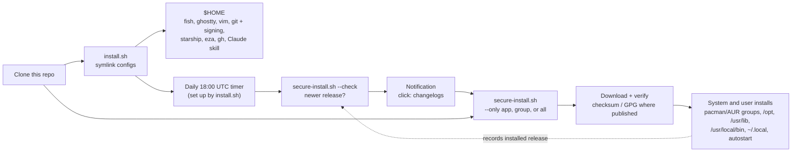

# Dotfiles

Public Fish, Ghostty and Vim setup for a Linux desktop, plus verified installs of desktop apps and a daily check for their updates. Package installs and home-directory symlinks are separate scripts.



## Install

```bash
git clone https://github.com/yelenkovsky/dotfiles.git ~/dotfiles
cd ~/dotfiles
chmod +x install.sh secure-install.sh setup/*.sh
./secure-install.sh --yes   # all packages
./secure-install.sh --list  # named targets (remnote, desktop, aur, …)
./secure-install.sh remnote # one vendor app; groups work the same way
./secure-install.sh audiorelay
./install.sh                # symlink configs into $HOME
```

`install.sh` resolves paths from its own directory, so the clone does not have to live at `~/dotfiles`. It replaces an existing symlink, and moves a real file aside into `~/dotfiles-backup-<timestamp>/`.

`secure-install.sh` loads every `secure-install/packages/*.sh`. Each script registers itself. Package groups (`core`, `desktop`, `util`, `fonts`, `gaming`, `aur`) install through pacman or yay. Gaming also installs `nvidia-prime`, the AUR package `mangojuice`, and the Proton-CachyOS Steam Linux Runtime x86-64-v3 build. Vendor apps download an artifact over HTTPS and verify it against the vendor's published checksum or GPG signature. Grayjay, AudioRelay, RemNote, Zotero, Todoist and debtap publish neither, so those get file-type and minimum-size checks only. ZapZap (WhatsApp) publishes no checksums either, so it installs as a per-user Flatpak from Flathub, whose commits flatpak verifies against Flathub's GPG key, and starts from `~/.config/hypr/autostart.lua`. Then they install under `/opt`, `/usr/lib`, `/usr/local/bin` or `~/.local`, with autostart entries where the app needs one. A running app is closed before its files are replaced and reopened afterwards; a new tree is staged and swapped in, so a failed copy keeps the working install. Files that a pacman package still owns are never overwritten: the installer stops and prints the `pacman -Rdd --dbonly` hand-over. `./secure-install.sh --help` shows `--only`, `--skip`, `--dry-run` and `--check`. Logs go to `~/.local/state/dotfiles-installer/`.

## App updates

`./secure-install.sh --check` runs each vendor installer up to the point where it would download the app, compares that release with the one recorded at the last successful install, and lists what is newer, with a link to its release notes. It needs no sudo and installs nothing. `install.sh` sets up a systemd user timer (`setup/update-check-timer.sh`) that runs the check daily at 18:00 UTC and sends a notification; clicking it opens the changelogs. Update with the command the check prints, for example `./secure-install.sh --only slack zoom`. Apps that update themselves (RemNote) are not checked.

## What is linked

| Path | Role |
| --- | --- |
| `.vimrc` | Vim |
| `.gitconfig` | Git identity, `gh` credential helper, and SSH commit signing through the Proton Pass SSH agent |
| `.config/git/allowed_signers` | Public signing key, so `git log --show-signature` verifies commits locally |
| `.config/fish`, `.config/omf` | Fish + Oh My Fish |
| `.config/starship.toml` | Prompt |
| `.config/ghostty` | Terminal |
| `.config/eza` | `ls` replacement theme |
| `.config/gh/config.yml` | GitHub CLI settings. Account credentials stay in a local `hosts.yml` |
| `.claude/skills/add-secure-install-app` | Claude Code skill for adding apps to `secure-install/packages/`, linked at `~/.claude/skills/add-secure-install-app` |

The Yazi config (`.config/yazi`) and Omarchy theme hooks (`.config/omarchy`) stay in the clone. Link those paths yourself when you want them in `$HOME`.

## Extra setup

Run these by hand when you need them.

- `setup/update-check-timer.sh` — the daily update-check timer (`install.sh` runs it; `--remove` turns it off)
- `setup/setup-wireshark.sh` — capture group permissions. Install Wireshark separately
- `setup/usb.sh` — format a removable drive as one FAT32 partition and mount it at `/mnt/usb`
- `setup/usb-remount.sh` — remount that drive with user write permissions

## Updating

These files are the copies that `$HOME` should symlink to. Edit them here (or via the home symlink), then commit in this repository.

## License

[MIT](LICENSE)
